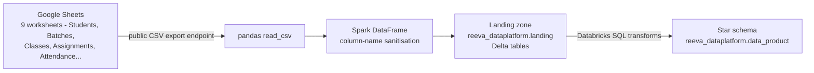
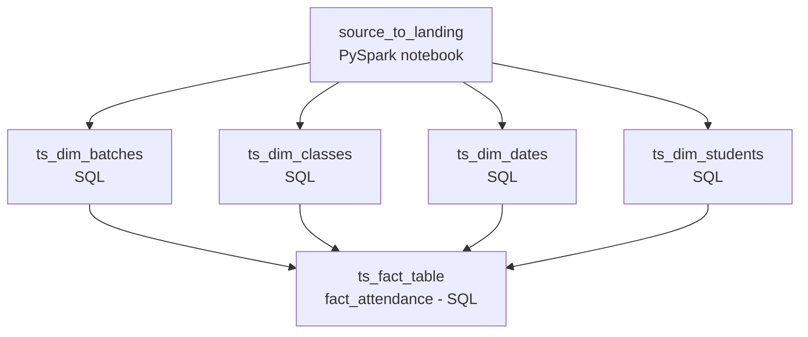

# 🎓 Reeva Education Data Platform

An end-to-end **ELT pipeline on Databricks** that turns raw **Google Sheets** data from an education / training academy — students, batches, classes, assignments, submissions, and attendance — into an **analyst-ready star schema** in **Unity Catalog**, orchestrated as a single scheduled job defined with a **Declarative Automation Bundle**.

The pipeline showcases a hybrid Lakehouse pattern: a **PySpark notebook** handles ingestion, while the dimensional modelling is done entirely in **Databricks SQL**, run on a SQL warehouse as dependency-aware job tasks.

---

## 🏗️ Architecture



## 🔄 Pipeline Orchestration

`jobs_pipeline_yamlfile.yml` defines the job `get_data_frm_gd_to_db` — a daily scheduled pipeline with queueing and task dependencies:



Dimensions are built in **parallel** after landing; the fact table **fans in** once all dimensions are ready.

## ✨ Design Highlights

* **Zero-credential Google Sheets ingestion** — worksheets are fetched through Google's public CSV export endpoint with `pandas`, converted to Spark DataFrames, and saved as Delta tables — no service accounts or API keys required for publicly shared sheets.
* **Landing-zone pattern** — all nine worksheets land as raw-but-sanitised Delta tables (snake_case columns), keeping the raw source reproducible in Unity Catalog.
* **SQL-first dimensional modelling** — ingestion in PySpark, modelling in version-controlled `.sql` files executed on a Databricks SQL warehouse — a clean separation of concerns and a natural CI/CD surface.
* **Surrogate keys & constraints** — dimensions use `row_number()`-generated keys with `PRIMARY KEY` constraints, and the fact table carries `student_key`, `class_key`, `batch_key`, and `date_key` foreign references.
* **Defensive data quality** — `TRY_CAST` safely converts malformed / `'nan'` timestamps from the spreadsheet source into NULLs instead of failing the load.
* **BI-friendly fact design** — `fact_attendance` includes `present_flag`, `absent_flag`, and `late_flag` columns, so attendance rates can be aggregated with simple `SUM`s in any BI tool.
* **Everything as code** — the notebook, SQL files, and the scheduled job all live in Git and deploy via a Databricks Declarative Automation Bundle.

## 📊 Data Model

| Table | Type | Description |
| --- | --- | --- |
| `fact_attendance` | fact | one row per attendance record, joined to all dimensions by surrogate keys, with present/absent/late flags |
| `dim_students` | dimension | student attributes (surrogate `student_key`) |
| `dim_classes` | dimension | classes and their batch / date references |
| `dim_batches` | dimension | course batches with start/end dates and status |
| `dim_date` | dimension | calendar dimension keyed by `date_key` |

Landing tables (raw): `students`, `batches`, `student_batch`, `classes`, `platforms`, `student_access`, `assignments`, `attendance`, `assignment_submissions`.

## 📁 Repository Structure

```text
reeva_data_platform/
├── jobs_pipeline_yamlfile.yml    # scheduled DABs job definition
├── src/
│   ├── notebooks/
│   │   └── ds2landing/            # Google Sheets → landing Delta tables
│   └── queries/
│       ├── dimensions/           # dim_student, dim_classes, dim_batch, dim_dates
│       └── facts/                # fact_attendance
├── documentation/                # design notes
└── README.md
```

## 🧰 Tech Stack

| Area | Tools |
| --- | --- |
| Platform | Databricks (serverless), Unity Catalog, Delta Lake |
| Ingestion | Python, pandas, Google Sheets CSV endpoint, PySpark |
| Modelling | Databricks SQL (SQL warehouse) — star schema |
| Orchestration | Lakeflow Jobs + Declarative Automation Bundles |

## 🚀 Getting Started

1. Make your source Google Sheet **publicly viewable** (File → Share → Anyone with the link).
2. Set your spreadsheet ID and target schema in the `ds2landing` notebook:

   ```python
   SPREADSHEET_ID = "<your-spreadsheet-id>"
   TARGET_DATABASE = "reeva_dataplatform.landing"
   ```

3. Run the `ds2landing` notebook to land the raw tables, then run the dimension and fact SQL files — or deploy and run the whole job:

   ```bash
   databricks bundle deploy
   databricks bundle run get_data_frm_gd_to_db
   ```

## 🔭 Possible Next Steps

* Incremental loading and SCD Type-2 handling for student/batch changes
* Additional fact tables (assignments, submissions, platform engagement)
* Row-level data-quality expectations and freshness alerts
* An AI/BI dashboard tracking attendance and dropout risk per batch

## 📄 License

This project is for portfolio / educational purposes.